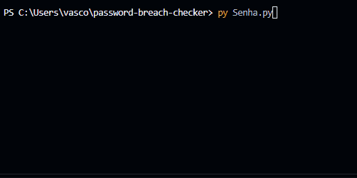

# 🔐 Password Breach Checker

> A privacy-focused tool to check whether passwords have appeared in known data breaches without sending the full password over the internet.


---



## ✨ Features

- Check one password or process multiple passwords from a `.txt` file.
- Ignore blank lines in batch files.
- Return results as formatted JSON, including the number of known exposures.
- Validate menu choices, password input, and file paths with guard clauses.

## 🛠️ How it works

Privacy comes first. This tool uses the **k-Anonymity** model provided by the Have I Been Pwned API to keep your real password safe during verification.

1. 🔒 **Local Hashing:** Your password is converted into a full SHA-1 hash locally.
2. ✂️ **Prefix Sharing:** Only the **first 5 characters** (prefix) of the hash are sent to the API.
3. 📦 **Suffix Fetching:** The API returns a list of matching hash suffixes along with how many times each hash appeared in known data breaches.
4. 💻 **Local Matching:** The script compares the full hash locally against the returned list to find a match. **Your plain password never leaves your machine.**

---

## 📊 What the number means (and doesn't)

- **What it means:** The count represents **historical exposure** in known data leaks.
- **What it doesn't mean:** It is **not** a measure of password strength or complexity. 
- ⚠️ **Important:** A count of **`0`** doesn't automatically mean your password is strong or unhackable—it simply means it has not been flagged in known data breaches yet.

---

## 🚀 Usage

### Prerequisites
- Python 3.8 or higher installed on your system.
- No third-party packages are required.

### Quick Start

1. **Run the checker from the repository directory:**
   ```bash
   python Senha.py
   ```

2. **Choose a verification mode:**
   - Enter `1` to check passwords from a text file, with one password per line.
   - Enter `2` to check a single password interactively.

For batch verification, select option `1` and enter `senhas_exemplo.txt` to try the sample file included in the repository. It contains fictional values, one per line:

```text
Exemplo-Ficticio-01-2026
Nao-Use-Como-Senha-Real-02
Senha-Demonstracao-03
```

You can also provide the path to another `.txt` file, with one password per line. Empty lines are skipped. The result is printed as JSON with a result for each password.

The sample values are only for trying out the batch workflow. Their presence or absence in the breach database is not guaranteed, and they should never be used as real passwords.

**Example output for a single password:**

```json
{
    "tipo_verificacao": "unica",
    "senha_analisada": "example-password",
    "vazada": true,
    "quantidade": 4210
}
```

**Privacy note:** The full password is not sent to the API; only the first five characters of its SHA-1 hash are sent. However, input files contain passwords in plain text, and the JSON output includes the checked passwords. Use only files you can protect, and never commit real password files or share their output.

**Example terminal session:**

```text
Verificador de vazamentos de senha:
1 - Verificação por lotes (Arquivos .txt)
2 - Verificação única (Input)
Escolha uma opção (1 ou 2): 2
Digite a senha que deseja consultar: example-password
```

The script prints the result as formatted JSON:

```text
--- OUTPUT JSON ---
{
    "tipo_verificacao": "unica",
    "senha_analisada": "example-password",
    "vazada": true,
    "quantidade": 4210
}
```

For a password with no matching entry, `vazada` is `false` and `quantidade` is `0`. A zero count does not guarantee that a password is strong or has never been exposed.

---

## 💡 What I learned

Building this project allowed me to deepen my understanding of practical cybersecurity principles:
- **k-Anonymity:** Learned how to query sensitive datasets safely without exposing client side identities or secrets.
- **Data Hashing:** Understood how standard hash functions like SHA-1 are used in cryptographic workflows.
- **REST APIs & Security:** Experienced consuming external APIs securely while handling edge cases and error responses cleanly.

---

## 🔮 Next steps

- [ ] Add a secure, customizable random password generator.
- [ ] Build a local brute-force demonstration tool (using harmless test passwords) to illustrate entropy and cracking speeds.

---

Developed with privacy in mind.
